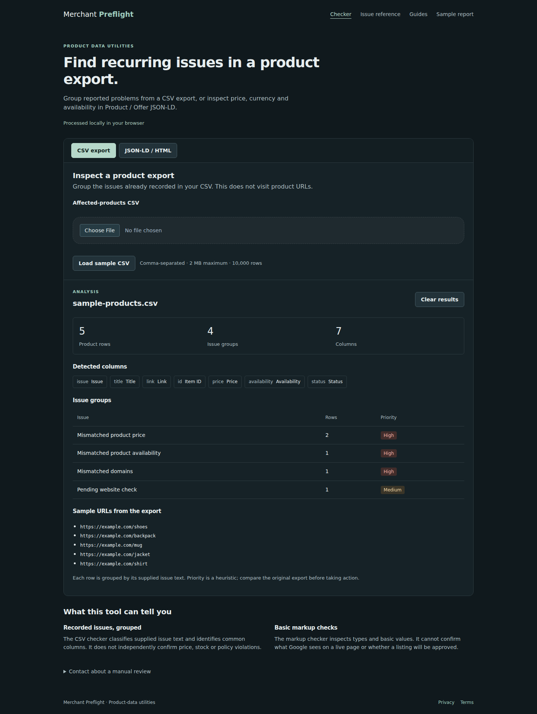

# Merchant Listing Preflight

Two browser utilities for investigating product data: group issue text from a CSV export, or inspect the basic values in Product / Offer JSON-LD. Built with React, TypeScript, Vite and React Router.

[Live application](https://merchant-listing-preflight.pages.dev/) · [Quality checks](https://github.com/flankero-dev/-merchant-listing-preflight/actions/workflows/quality.yml) · [Engineering decisions](docs/decisions.md)

This is an independent project. Included product data and the worked report are fictional examples.



## Review it in two minutes

1. Choose **Load sample CSV**. Expect **5 product rows**, **4 issue groups** and **7 columns**; the price issue contains two rows.
2. Clear the results and upload a comma-separated export. Try duplicate headers or an incomplete quoted field: the checker reports the problem instead of displaying a partial analysis.
3. Switch to **JSON-LD / HTML**, load the sample and choose **Analyze markup**. The Product, Offer, price, currency and availability checks pass.
4. Change the sample price to `"abc"` and analyze again. The Price check fails. Switch formats: the CSV result and markup input stay available.
5. Open a guide or the worked report, then choose Checker in the menu. Your current format, inputs and results remain available. Direct route links and the not-found page also work.

Files and markup are processed locally. The checker groups supplied issue text; it does not visit product URLs or compare live prices with a feed.

## Code worth reviewing

| Decision | Implementation | Evidence |
|---|---|---|
| Reject malformed input before classification | [CSV parser and analyzer](src/lib/csvAnalysis.ts) | [Quotes, multiline values, BOM, duplicate headers and row shape](tests/csvAnalysis.test.mjs) |
| Match real column aliases | [Column detection](src/lib/csvAnalysis.ts) | Exact aliases win; `Grid` is not mistaken for `ID` |
| Check the supplied Product's own Offer | [Markup analysis](src/lib/schemaAnalysis.ts) | [Typed offers, unrelated graph nodes and invalid values](tests/schemaAnalysis.test.mjs) |
| Read HTML attributes without executing markup | [Attribute extraction](src/lib/schemaAnalysis.ts) | Quoted/unquoted attributes, comments and HTML-like JSON strings |
| Keep each input when changing format | [Workspace](src/components/CheckerWorkspace.tsx) | [Format persistence and file re-selection](tests/browser-smoke.mjs) |
| Handle real navigation and small screens | [Route scrolling](src/components/RouteScroll.tsx), [central metadata](src/components/SEOHead.tsx) | Deep links, anchors, mobile cards and long results in browser smoke |

Guides provide short investigation checklists with links to Google's documentation. The worked report distinguishes illustrative evidence from output produced by the checker.

## Run locally

Use Node.js 24 and npm.

```sh
npm ci
npm run dev
```

To inspect a production build manually:

```sh
npm run build
npm run preview
```

## Verify

Run the browser suite as a separate command; it starts and stops its own preview server.

```sh
npm test
npm run lint
npm run build
npx playwright install chromium
npm run test:browser
```

Node tests cover the analyzers. Playwright checks sample data, uploads and errors, re-selection, format switching, route navigation, mobile layouts and the contact form. CI runs all checks and stores browser screenshots as artifacts.

## Boundaries

- CSV: comma-delimited, up to 2 MB per uploaded file and 10,000 product rows. Semicolon and tab delimiters are not supported.
- JSON-LD: up to 2 million input characters; checks inspect the first Product and a directly nested, typed Offer. Referenced offers, AggregateOffer, custom contexts and variant comparison are not resolved.
- Priority is a heuristic based on issue text. Passing markup checks does not establish Google eligibility or confirm live stock or prices.
- The optional contact form opens a draft in the user's email app. It does not send mail or submit data to a backend.
- Chromium browser workflows are covered. A full assistive-technology and cross-browser audit remains outside the tested scope.
